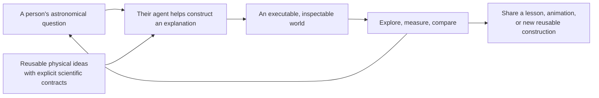
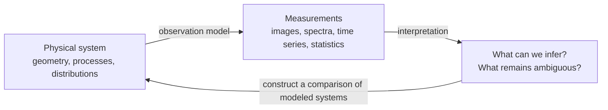
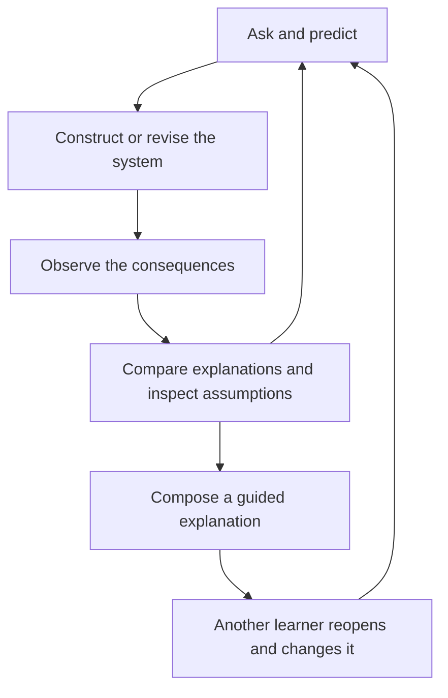
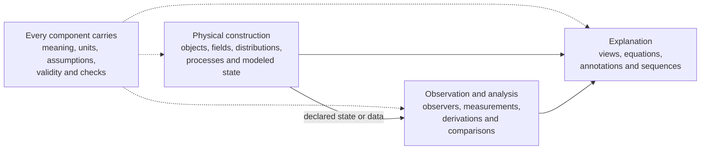
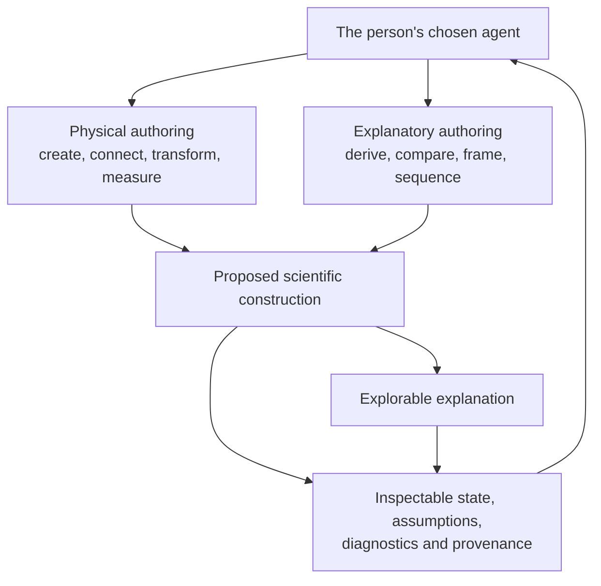
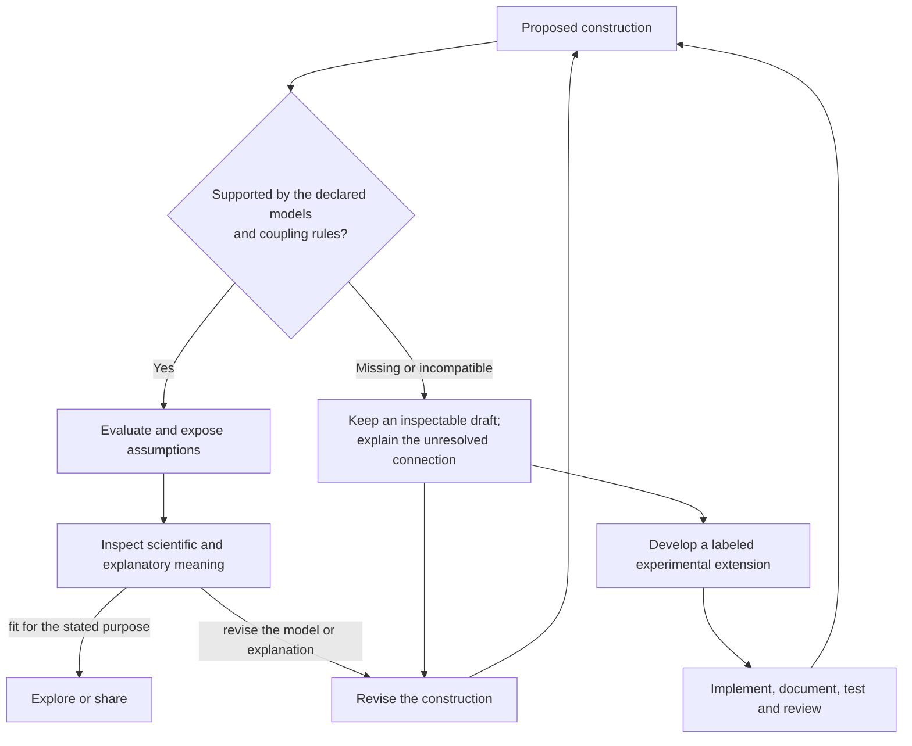
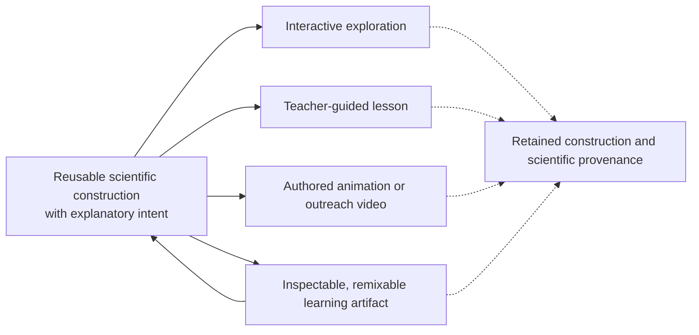
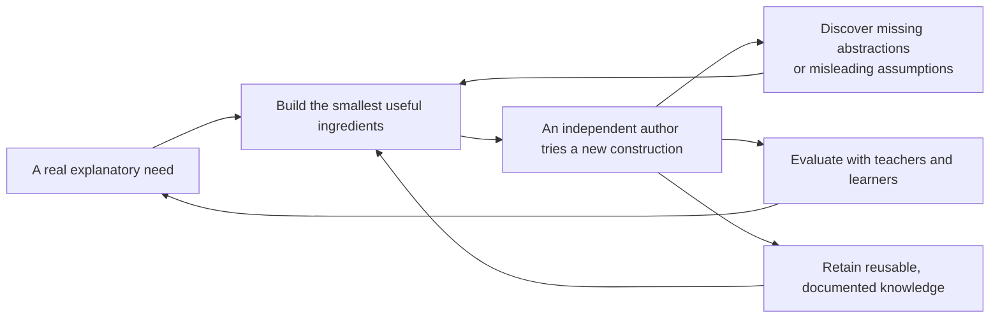

# AstroCompose

**A language of reusable physical ideas, through which people and their agents
can construct, explore, and share astronomical explanations.**

AstroCompose aims to make an astronomical question the starting point for a new
interactive explanation. A teacher, student, or creator should be able to work
with their own LLM agent to assemble scientific building blocks, change their
relationships, inspect the consequences, and turn that exploration into a
communicable explanation.

The intended product combines a reusable toolkit with a reference authoring and
exploration environment. “Language” means a vocabulary of meaningful components
and operations; it does not require inventing a new programming language. The
toolkit preserves scientific meaning, and the environment makes it usable.

This document is the project's statement of purpose and design commitments. It
describes the intended system, not a list of delivered features. Individual
domains and prototypes test this vision; they do not define its limits.

## Why astronomy needs this

Astronomy asks learners to reason about systems they cannot usually manipulate
directly. Relevant scales may span many orders of magnitude. Three-dimensional
geometry becomes a two-dimensional image; physical processes become light,
spectra, particle statistics, or other measurements. An explanation must connect
what a model says is happening with what an observer can actually infer.

A static illustration chooses one configuration and one viewpoint. An animation
chooses a sequence. A carefully designed interactive lab opens a set of questions
its author anticipated. All are useful. The unmet need motivating AstroCompose
appears when a learner asks a different question: change the system's structure,
combine mechanisms, add an observer, compare two explanations, or invent a new
representation of the result. Producing that next explanation should not require
rebuilding an entire scientific visualization from scratch.

Reusable code can reduce the cost of making that comparison. An LLM can help a
person express intent, discover relevant components, and assemble a construction.
Neither capability alone supplies the missing educational environment: the
construction also needs explicit scientific meaning, inspectable assumptions,
and a way to question its result.

The project therefore joins three kinds of work: reusable domain modeling,
agent-assisted authoring, and visual inquiry. Its educational premise is that
lowering the cost of a scientifically accountable follow-up question can support
deeper exploration. That is a hypothesis to evaluate with teachers and learners,
not an established learning outcome of this project.

Prior work supports the design rationale without establishing this project's
effectiveness. [Research on PhET](https://phet.colorado.edu/publications/prst-per-2010.pdf)
documents learners posing and investigating questions through carefully designed
simulations. [Astronomy representation research](https://doi.org/10.1103/PhysRevPhysEducRes.14.010145)
shows that diagram choices can shape learners' explanations of familiar
phenomena. [SimStep's authoring study](https://arxiv.org/html/2507.09664v1)
explores inspectable representations between educational intent and generated
simulations, while documenting consistency problems. These motivate deliberate
inquiry design and inspectable authoring; they do not prove that adding an LLM
improves learning.

## The experience we want to enable

Imagine a learner asking: **“Can a different physical arrangement produce the
same signal? Help me build both, then find a measurement that separates them.”**

The agent should be able to construct both arrangements, retain their identities,
connect suitable measurements, and arrange a comparison. The learner can inspect
the assumptions, predict the outcome, change the construction, and ask a more
precise question. A teacher can turn that investigation into a guided lesson; a
creator can turn it into an original animation. The same scientific construction
should remain available for inspection and further exploration.

The main surface should make the modeled world and the explanation feel present:
motion, spatial relationships, measurements, equations, and annotations should
work together. Direct manipulation and conventional controls remain useful when
they serve the question. The ceiling of the experience is set by what people can
construct, not by the controls supplied with a particular demonstration.

Learners should be able to open, inspect, play, and use an artifact's available
interactions without programming or LLM access. Creating new structures may use
an agent or code. Both routes should operate on the same scientific construction;
ordinary authoring should not demand expertise in the underlying solver.

## Four words that define the ambition

| Commitment | What it means for AstroCompose |
| --- | --- |
| **Arithmetic** | Scientific explanations are programmable constructions. Authors combine quantities, objects, processes, relationships, measurements, and representations using meaningful operations. Arithmetic includes derived quantities and transformations, not merely numerical inputs or decorative equations. |
| **Interactive** | Exploration changes both values and structure. A person can add, remove, reconnect, inspect, compare, pause, and revise while receiving interpretable feedback. |
| **Infinite possibilities** | A finite library should support constructions its authors did not enumerate. This is an ambition for open-ended expression within declared scientific and computational limits, not a claim that every imaginable combination is valid. |
| **Future-proof** | Scientific meaning and authored work should survive changes in agents, providers, renderers, and delivery formats. This is a commitment to portability, explicit contracts, and evolvability, not a promise that software never needs maintenance. |

## Scientific building blocks, with meaningful connections

A building block carries more than a visual shape. It has a scientific meaning,
state or data, units, assumptions, a regime of applicability, and supported
connections. Some blocks represent objects; others represent fields,
distributions, physical processes, observation models, or mathematical
transformations. A domain supplies the specialized knowledge needed to make
those blocks useful.

This is a conceptual map of responsibilities, not a mandated class hierarchy,
execution pipeline, or software stack. Static models, statistical models,
analytic models, numerical solvers, and appropriately documented datasets may
require different implementations.

The library supplies reusable laws, approximations, and operations. Authors
supply the particular construction and explanatory purpose. Compatible blocks
can be composed; incompatible assumptions must be surfaced. Cross-domain
connections require an explicit scientific mapping or adapter, not merely
matching names or visually plausible behavior.
That mapping must account for exchanged quantities, units and frames, time or
sampling conventions, and any shared state or feedback. Relevant conservation
requirements and approximations belong to the connection's contract. A
conversion between representations and a dynamically coupled model need not
have the same obligations.

The following are illustrative directions, not a feature list or a domain order:

| Scientific question | Possible reusable ingredients | What an author could construct |
| --- | --- | --- |
| How does an observer distinguish hidden planetary arrangements? | Bodies, orbital models, observers, occultation and measurement models | Systems with different geometries; shared or selective signals; alternative observing strategies |
| How do microscopic rules shape a statistical description? | Particle populations, collision rules, boundaries, sampling and distributions | Compare initial populations and collision assumptions; connect trajectories to evolving statistics |
| How does matter modify the light we receive? | Sources, media, transfer models, geometry and detectors | Compare sightlines or media; connect physical conditions to spectra and images |
| How does a coordinate or reference choice affect an explanation? | Coordinate maps, reference frames, trajectories, scales and labels | Linked representations with explicit transformations and preserved physical meaning |

No single solver needs to reconstruct the universe from fundamental particles.
Each domain may begin with the smallest defensible model that serves an
explanatory need. Its assumptions must remain visible when it is reused.

## Agents must author structure and explanation

An agent needs handles on components and their relationships. It should be able
to discover available capabilities, create and retain objects, connect and
reconnect them, apply meaningful transformations, evaluate outcomes, inspect
errors, and revise a construction. Loops, functions, reusable recipes, and
compositions should express ideas that no preset anticipated.

That authority extends to presentation: constructing a derived plot, arranging
linked views, introducing an equation, comparing saved states, or sequencing an
explanation. Reusable visual and explanatory components belong to the vision
alongside physical ones. A fixed dashboard would leave half the project undone.

Within supported models, authors may define local helper functions, derived
quantities, visual operators, and reusable compositions through the authoring
interface. Those constructions retain traceable inputs and scientific meaning.
Introducing new dynamics, a new observation law, or a new regime of applicability
is model development, with additional verification responsibilities.

Serialization formats and tool protocols are implementation choices. They must
carry the construction's structure and meaning without becoming a ceiling on
authoring. A user's preferred agent should be able to participate through a
documented interface; scientific behavior should not depend on a particular LLM
provider or on access to a model during playback.

## Where scientific responsibility lives

The person supplies a question and judges the explanation. The agent proposes
and assembles constructions. Domain implementations evaluate their declared
models; contracts and tests check known requirements. Scientific and pedagogical
review examine what those checks cannot establish.

An agent may help develop a new model, but that work is a distinct contribution
that needs verification. It must not silently invent a missing law or weaken a
constraint just to satisfy a requested scene. Instructions to an LLM explain
the rules; they are not the mechanism that enforces those rules. Passing a
contract means satisfying specified checks, not proving general physical truth.

Incomplete or incompatible constructions can remain editable drafts; they must
not produce results presented as supported scientific predictions. A deliberate
approximation is usable when it has its own declared assumptions and validity
contract. Experimental models may be developed and explored with their status
visible. Admission to the supported reusable library requires documented
assumptions, reference cases, tests, and scientific review appropriate to the
model. Community contributions follow the same standard. Ordinary composition
within a supported contract does not require a new approval for every scene.

Several commitments apply across domains:

- Quantities and connections retain their units, definitions, reference frames,
  and applicable assumptions. Mathematical operations must respect their meaning.
- Views of the same system derive from consistent declared state or data.
  Comparisons, sampling windows, and differing time conventions are explicit.
- Physical evolution, observation, and presentation are distinguishable. A
  camera move or exaggerated marker must not silently change an observable.
- Changing a model configuration is distinct from applying a physical
  intervention. A transformation states what is held fixed and what is derived.
- Observations, model predictions, schematics, and artistic illustrations remain
  distinguishable. Explanations expose relevant approximation and provenance.

## One scientific construction, many forms of explanation

The inspiration from Manim is programmatic visual expression: an author builds
an explanation from reusable ideas and transformations. Astronomy adds physical
models, observational consequences, and scientific coupling rules to that aim.
Whether Manim becomes one rendering route is an implementation question.

These forms may need different pacing, layouts, accessibility choices, and
technical delivery. They should reuse scientific meaning rather than create
separate, inconsistent versions of the explanation. Web, desktop, notebook,
rendered media, and other delivery environments remain choices to evaluate
against real authoring needs.

Rendered exports must remain traceable to a retained, editable construction and
its scientific provenance. Preserve model and data identities, assumptions,
units, explanatory intent, and random seeds or sampling procedures where
relevant. Reproduction should recover the construction and its scientific
results under stated tolerances or statistical criteria; identical pixels across
all renderers are not the goal. Changes in model meaning must be explicit when
an artifact is migrated.

## How the project should grow

The immediate creative motivation is to make original astronomical explanations
more practical to produce. The broader ambition is a shared vocabulary that
teachers, students, researchers, and creators can extend and reuse. A useful
construction can contribute both an educational artifact and a tested building
block for the next author.

Original content creation is the first practical proving ground. Early tradeoffs
should favor a useful explanation whose ingredients become reusable and whose
claims remain open to learner investigation. Broad topic coverage and cinematic
polish alone should not take priority over that work. Classroom use then provides
a separate test of whether the toolkit serves teaching and learning.

We should expand the vocabulary when a new explanation requires it, keeping
domain knowledge modular and resisting a universal ontology designed in
advance. Scientific contracts and reusable artifacts deserve continuity;
renderers, agent adapters, internal representations, and application shells
should remain replaceable. Compatibility and migration require deliberate work.

Progress is demonstrated when an independent author can create an unanticipated,
scientifically defensible explanation without rewriting machinery that already
supports the idea; when a learner can investigate a meaningful follow-up
question; and when another person can inspect, reproduce, and adapt the result.
We must separately evaluate authoring effort, scientific reliability, and
learning. Attractive output, a successful agent run, and a growing asset count
do not establish all three.

A concrete authoring test is to give an independent collaborator an existing
component vocabulary and an unfamiliar explanatory question. Can they rearrange
the physical construction, derive a new comparison, author a linked view or
explanatory sequence, and save a result another person can reopen—all through
the public authoring interface? Record the effort, failures, and missing
capabilities. A request for unavailable physics should produce an explained
limitation or a reviewable extension. Learning evidence must examine learners'
reasoning and transfer, separately from whether the construction runs.

**The enduring goal is to make scientific ideas reusable enough that a new
question can become a new explorable explanation.**

---

Practical instructions belong in the [authoring guide](docs/getting-started.md).
Prototype scope and evidence belong in the [implementation record](docs/demo-status.md).
Neither replaces this statement of purpose.
