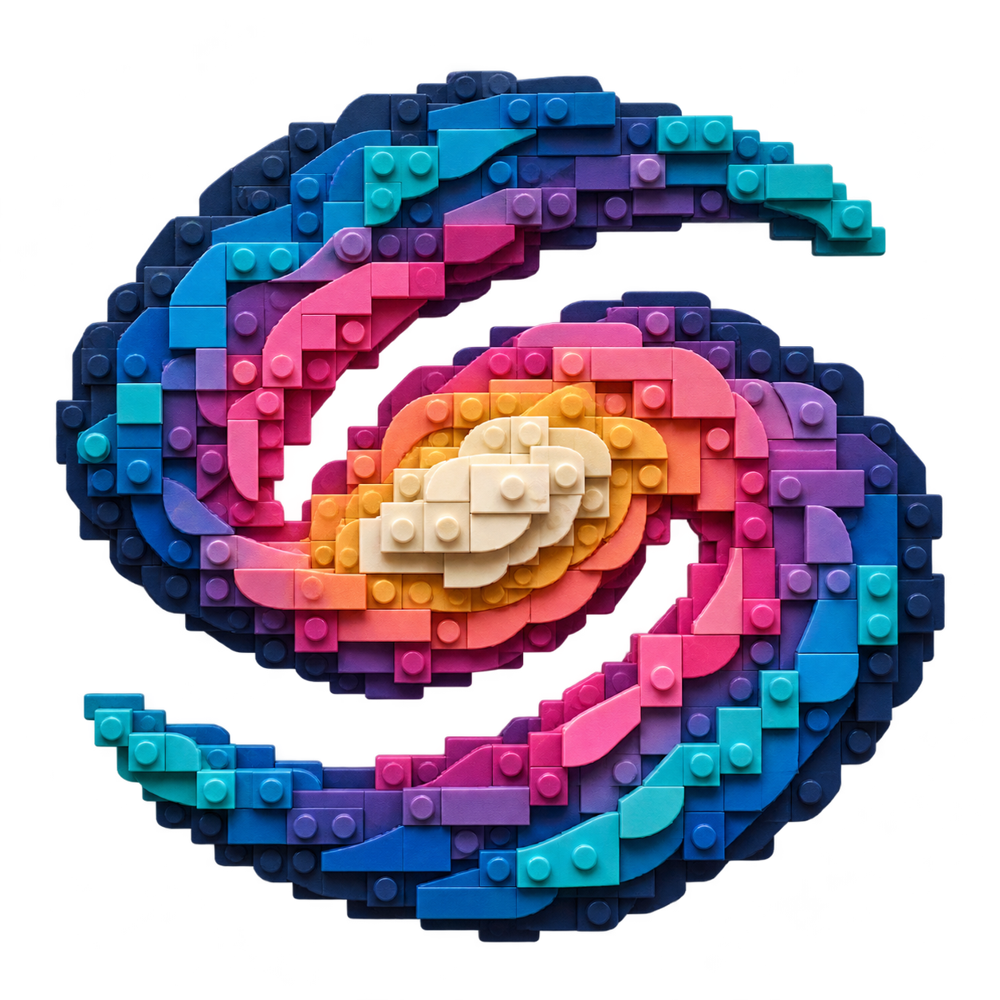
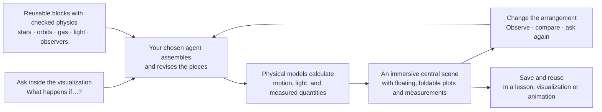

# Cosmic Lego

**Reusable scientific building blocks for interactive astronomy visualizations.**

Cosmic Lego aims to let students, teachers, and creators work with their own LLM
agents to assemble stars, planets, gas, light, and observers into interactive
visualizations. They should be able to add objects, change physical relationships,
choose what to measure, and build views that make the consequences visible.

We supply reusable physics and visualization tools; an agent helps a person put
them together. The result should remain explorable, inspectable, and editable.
This document describes our purpose and intended capabilities, not a catalogue
of delivered features.

## The whole idea

**The agent arranges the pieces; the implemented models supply the physical
rules. The scene and its measurements must describe the same modeled objects.**

## Why astronomy especially needs this

In introductory physics, chemistry, and biology, students can often learn through
experiments: change a circuit, compare a reaction, or examine cells under a
microscope. Many basic concepts have a classroom or everyday counterpart, even
though these sciences also study inaccessible phenomena.

Astronomy frequently lacks that immediate connection. We can observe a star,
but cannot move around it to inspect its geometry, place another planet beside
it, or wait through its lifetime. Distances and times range far beyond everyday
intuition—from microscopic interactions that produce spectral lines to the
formation and evolution of galaxies. Even when an astronomical image is familiar,
the spatial arrangement, motion, and physical processes behind it may not be.

Interactive visualizations let a learner rotate an orbit, look along another
sightline, follow a particle, or watch slow or fast motion at a readable pace.
Interactive 3D is particularly useful when geometry matters; light curves,
spectra, diagrams, and equations connect that geometry to measurable quantities.
The relevant relationships matter more than rendering every topic in 3D.

Creating such a visualization should not become a second course in graphics
programming or prompt engineering. Beginners should spend their time understanding
transits, temperature, or radiation, rather than repeatedly coding simulations or
coaxing an LLM into drawing them correctly. Models, views, and examples can be
shared and reused. When the necessary physics exists, a new question should need
a new arrangement of those pieces.

## What people should be able to explore

| A question | What the learner and agent could build |
| --- | --- |
| **What happens when several planets cross the same star?** | Add planets with different sizes, orbital planes, eccentricities, and phases. Link the orbital view, the observer's view of the stellar disk, and the combined light curve. Move the observer and see which transits disappear. |
| **Does a hotter star always look brighter?** | Compare idealized stars at fixed radius or luminosity. Change distance or wavelength band, linking the comparison to spectra and received flux. Keep this thermal-emitter approximation distinct from real stellar atmospheres or evolution. |
| **How do particle motions relate to gas temperature?** | Compare random particle motion relative to the mean flow, apply a stated collision model, and connect trajectories to velocity distributions. Distinguish heating from faster collective motion, and investigate which equilibrium the model predicts. |
| **Why does the same source look different through different material?** | Place gas or dust along a sightline and compare images or spectra using available absorption, emission, or scattering models. Show which change comes from the source and which comes from intervening matter. |

The library should grow through real astronomical questions, beyond any
predetermined set of demonstrations.

## Building blocks that agents can actually assemble

A star should be an object an agent can retain and connect to other pieces—not
an entire prepackaged experiment. Orbits, gas populations, light sources,
measurements, and plots need ways to be created, connected, changed, and reused.
Their quantities, units, assumptions, and limits of applicability travel with them.

Agents need freedom to change both astronomy and presentation: add an observer,
derive a comparison between signals, place views side by side, or sequence an
animation. Loops, functions, and reusable recipes should express combinations
the library's authors did not anticipate.

The project includes reusable code and a place to explore its results. Existing
visualizations should open, play, and support their available interactions without
programming or LLM access. Agents or code help learners build new arrangements.

The common foundation must work across topics: constructing objects, connecting
quantities, evolving models, drawing results, conversing with an agent, and saving
or presenting a creation. Astronomy packages supply the particular physics and
assets. A new topic should not need a new application or conversation interface.
The foundation must also work without an astronomy package loaded; exoplanets
are one application of it, not its underlying vocabulary.

## A place to explore, like a planetarium

The visualization should occupy the main stage. A learner can move around the
scene, select something interesting, and ask their own agent to change or extend
it from within the same app. Plots, equations, object details, and the conversation
float above the scene and can be moved, folded, or hidden. A clear way to restore
them makes it easy to move between watching and investigating.

Imagine following gas through a region of space, opening a velocity distribution
over the scene, then asking for a second population to compare. Or inspect an
orbit, ask for another observer, and bring its measurement into view. The agent
can construct new arrangements and views using the available blocks. Sliders
and numerical inputs remain useful for precise adjustments, but do not define
the limits of exploration.

This is a planetarium-like workspace, not a requirement to make every concept
three-dimensional. A spectrum or diagram can become the main view when it best
serves the question. The user's chosen compatible agent supplies the conversation;
the implemented models and checked operations govern changes to the visualization.

## Four commitments

| Commitment | What it means here |
| --- | --- |
| **Arithmetic** | Calculate and combine meaningful quantities and visual elements: derive a flux difference, transform coordinates, connect particle motions to a histogram, or turn a physical relation into an animation. |
| **Interactive** | Change objects and their relationships as well as numerical values. Observe the consequences through linked views and measurements. |
| **Infinite possibilities** | A finite set of pieces should support unanticipated combinations. Physical assumptions and computational limits still apply; not every conceivable connection is valid. |
| **Future-proof** | Keep physics and saved visualizations usable as agents, renderers, and formats change. People choose their agents; playback does not depend on a model provider. Maintenance and migration will still be necessary. |

## The physics must remain accountable

An LLM helps assemble a visualization; it does not decide the laws of nature.
Physical behavior comes from implemented models with stated assumptions and
checks. Changing eccentricity at fixed semimajor axis does not change the
Keplerian period. Moving a presentation camera must not silently change a
measured light curve. Particle velocities are not automatically an emission
spectrum: that connection needs its own physics.

Supported pieces can be rearranged within their stated limits. The agent should
identify connections that need missing physics. New models can be developed
experimentally, with that status visible; admitting them to the supported library
requires documentation, reference cases, tests, and appropriate scientific
review. Passing those checks does not prove every application correct.

Distinguish observations, model predictions, and artistic illustrations. Make
changes of scale, time, viewpoint, or approximation clear when they affect
interpretation. Saved work should retain the editable objects, calculations,
assumptions, data sources, and relevant random procedures behind a plot or
animation. Reproduction concerns scientific results under stated criteria,
rather than identical pixels on every computer.

## How we want this to grow

Original astronomy content is the first proving ground. Each useful visualization
should contribute pieces others can adapt. Interactive exploration and authored
animation should share physics while allowing different pacing and presentation.
Manim inspires this programmatic freedom; language, renderer, platform, and use
of Manim itself remain open choices. We do not need one solver that simulates the
universe from the bottom up.

Progress means an independent author can answer an unfamiliar astronomy question,
build a new comparison or view, and save something others can reopen, without
rewriting supported physics. Record effort, failures, and missing pieces;
separately test whether learners understand and apply the concepts.

[PhET research](https://phet.colorado.edu/publications/prst-per-2010.pdf) supports
carefully designed opportunities for learners to ask and investigate questions.
[Astronomy representation research](https://doi.org/10.1103/PhysRevPhysEducRes.14.010145)
shows that diagram choices can affect learners' understanding.
[SimStep's authoring study](https://arxiv.org/html/2507.09664v1) illustrates both
the promise of agent-assisted simulation creation and the difficulty of keeping
its representations consistent. These motivate our approach; they do not yet
establish Cosmic Lego's educational effectiveness.

**The goal is to spend less effort rebuilding visualizations and more time
exploring astronomy.**

## License

Cosmic Lego is released under the [BSD 3-Clause License](LICENSE), a permissive
software license also used by [Astropy](https://docs.astropy.org/en/stable/license.html).
It permits use, modification, and redistribution, including commercial reuse,
with the required notices retained and no implied endorsement by the authors.

Unless otherwise noted, this license covers the project's code, examples,
documentation, and original assets to the extent the contributors hold the
relevant rights. Third-party materials and trademarks retain their own rights.
[arXiv's article licenses](https://info.arxiv.org/help/license/index.html) apply
to manuscripts; any future Cosmic Lego paper would be licensed separately.

---

Practical instructions belong in the [authoring guide](docs/getting-started.md).
The implemented generic F01 API has its own [composition guide](docs/composition-kernel.md).
Scientific values, ports and calculations are covered in the [F02 dataflow guide](docs/scientific-dataflow.md).
Trusted model, operator, asset and view registration is covered in the [F03 extension guide](docs/extension-registry.md).
Analytic and stateful worker execution is covered in the [F04 runtime guide](docs/computation-runtime.md).
Authorable 3D scenes, scientific bindings, and reusable assets are covered in the
[F05 scene guide](docs/scene-and-assets.md), with a [runnable example](examples/scene-and-assets.mjs)
and [implementation handoff](docs/handoffs/F05.md).
F01–F05 are implemented; F06 will build the application shell around these interfaces.
Current capabilities and evidence belong in the [implementation record](docs/demo-status.md).
The [shared architecture roadmap](docs/infrastructure-roadmap.md) translates this
purpose into implementation tasks and agent prompts.
