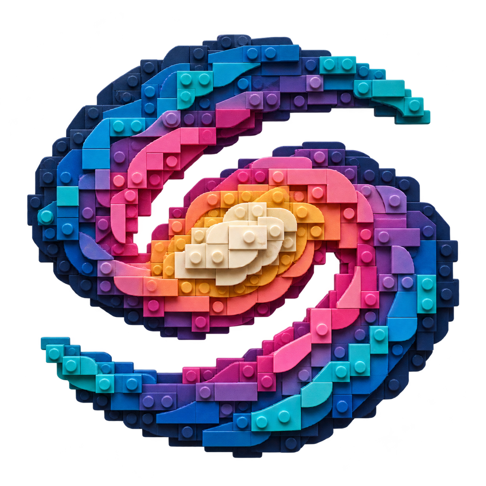

# Cosmic Lego brand mark

The approved logo is [cosmic-lego-galaxy.png](cosmic-lego-galaxy.png): a transparent
1254 × 1254 RGBA PNG showing a spiral galaxy assembled from interlocking bricks.
The owner selected this mark on 2026-11-02. Use it in project documentation,
the viewer header, and the favicon.

## Design and use

Many distinct pieces form one coherent celestial structure. A raised ivory/gold
core and two blue/teal spiral arms express the project's astronomy scope and
reusable-building-block idea. Open spaces between the arms preserve the galaxy's
silhouette; coral, violet, and magenta plates supply depth and visual variety.

Preserve the original image bytes and transparent background. Scale it with
normal image interpolation rather than pixel-art rendering, and keep the project
name as editable text beside it. The fine relief is intended for medium and large
placements; favicon display retains the overall shape and color structure.

The galaxy is an artistic branding metaphor, not an astronomical observation or
physical model. It contains no corporate logo or lettering and does not imply
affiliation with the LEGO Group.

## Provenance

The [design and generation record](galaxy-design.md) preserves the exact prompt,
reference-image role, and inspection notes. The approved PNG was copied from the
built-in image-generation output without raster edits. All four corners are
transparent; about 46% of the pixels are fully transparent.

The superseded mark and its earlier design notes remain in Git history.
