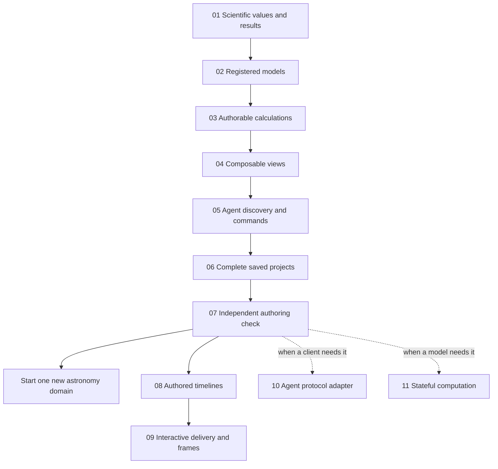

# Cosmic Lego infrastructure roadmap

Plan dated 2026-11-02, based on the [project blueprint](../README.md) and the
prototype at commit `75738e9`. These are implementation tasks, not delivered
capabilities. Read the current checkout before starting a task: later work may
already satisfy part of it.

Build six small shared layers, then test them with an independent author. Use
the existing exoplanet physics to prove the infrastructure before adding another
substantial astronomy topic. Timeline/export work can follow for outreach
production; a new agent protocol and a stateful runtime are conditional needs.

The first complete result should be an agent-authored multi-planet visualization
that compares correct combined transit flux with a deliberately naive
calculation, displays the geometry and both curves in linked views, and saves a
creation another person can reopen and explore without an LLM.

## Infrastructure we already have

| Keep and extend | Where it exists | What is still missing |
| --- | --- | --- |
| Ordinary code authoring and stable object handles | [SDK](../src/sdk.js), [recipes](../examples/cosmic-clockwork.mjs) | Registered calculations and view construction through the same public interface |
| Atomic semantic edits and reference checks | [scene operations](../src/scene.js), [HTTP service](../src/server.js) | General model dispatch, richer diagnostics, transaction preview and discoverable schemas |
| Physical evaluation and model-specific sampling | [physics](../src/physics.js), [sampling](../src/scene.js) | Common scientific result descriptions and explicit model/version requirements |
| Camera/observer separation and interactive playback | [viewer](../src/app.js) | Author-arranged views and explicit presentation-time evaluation |
| CLI, local HTTP access and tool discovery | [CLI](../scripts/agent.mjs), [agent guide](agent-interface.md) | Structured argument/output contracts; a protocol adapter only if useful |
| Graph saving and generated reconstruction source | [server launcher](../scripts/serve.mjs), [SDK](../src/sdk.js) | Faithful project saving, original recipe retention and portable delivery |
| Numerical and authoring checks | [tests](../test), [independent exercises](demo-status.md) | Shared extension-contract checks and a fresh end-to-end author challenge |

The present graph and compiler hard-code stars, planets, Kepler orbits and transit
measurements. The viewer expects one selected photometer. Tool arguments are
described largely in prose. Saved scene JSON does not preserve the complete
original authoring program or presentation composition. These are the concrete
seams to improve; a replacement of the entire prototype is unnecessary.

## Implementation order and prompts

Each prompt below is self-contained and approximately 500–600 words. Copy the
entire linked file into a new coding-agent conversation. It includes repository
context, prerequisites, implementation scope, acceptance checks and a handoff
requirement. The dependency column refers to integrated, tested results, not
merely another agent having started that task.

| Order | Task and copy-ready prompt | Required result | Depends on |
| --- | --- | --- | --- |
| 01 | [Scientific values and shared results](prompts/01-scientific-values.md) | Units, meanings, reference frames and time, normalization, revision-tagged results and sampling metadata | — |
| 02 | [Registered physical models and coupling rules](prompts/02-model-packages.md) | Extract current physics into registered modules; shared graph no longer assumes every world contains one star | 01 |
| 03 | [Authorable arithmetic and derived measurements](prompts/03-derived-calculations.md) | Saveable calculations and curves made through SDK handles, with explicit sample alignment | 01, 02 |
| 04 | [Composable linked views and drawing primitives](prompts/04-composable-views.md) | Author-arranged spatial views, projections, plots and labels using common results | 01–03 |
| 05 | [Agent discovery and reliable commands](prompts/05-agent-contracts.md) | Machine-readable capabilities, non-mutating preview, actionable errors and consistent revision checks | 02–04 |
| 06 | [Complete project saving and reopening](prompts/06-portable-projects.md) | Preserve graph, calculations, views, requirements, provenance and original source across restart | 01–05 |
| 07 | [Independent authoring readiness check](prompts/07-independent-author-gate.md) | A fresh author builds and reopens an unfamiliar composition using public interfaces only | 01–06 |
| 08 | [Authored timelines](prompts/08-authored-timelines.md) | Seekable pauses, camera movements and explicit configuration comparisons | 07 |
| 09 | [Interactive delivery and frame export](prompts/09-interactive-and-frame-export.md) | A portable local interactive creation and image sequences from the same presentation evaluator | 08 |
| 10 | [Optional external-agent adapter](prompts/10-optional-agent-adapter.md) | One tested client connection translating the established public operations | 07; optional |
| 11 | [Conditional stateful computation](prompts/11-conditional-stateful-runtime.md) | Bounded stepping, jobs, cancellation and checkpoints when a real workload needs them | 07; conditional |

Run 01–07 sequentially by default. They touch shared contracts and often the same
small source files; giving them to simultaneous agents in the same checkout
would create conflicting assumptions. After 07, tasks 08, 10 and planning for a
new domain can proceed independently if their file ownership and interface
versions are explicit. Task 09 follows 08. A new domain that needs step-based
evolution should settle task 11's narrow interface before depending on it.

If a task exposes a missing primitive in its prerequisites, fix that owning task
and update its handoff. Do not copy a second validator, calculation engine or
renderer into a downstream feature. Reassess the plan after 03 and again after
07; these checkpoints can reduce or reshape later work.

## The concrete proving case

The existing [overlap exercise](../experiments/agent-a-overlap.mjs) already
contains the scientific ingredients. Infrastructure should let another author
express the following without changing the numerical core or adding a special
viewer page:

1. Create several planets with independently chosen orbital properties and a
   physical observer.
2. Obtain the true combined flux from the union of their projected silhouettes,
   plus individual-planet fluxes normalized to the same unobscured star.
3. Construct `F_naive = 1 - sum(1 - F_i)` and `F_union - F_naive` using
   reusable calculation handles. Clearly identify the naive sum as a deliberately
   incorrect overlap approximation.
4. Arrange orbital geometry, the observer projection, true/naive curves and the
   difference. An author can rearrange or replace a view using public primitives.
5. Scrub one physical time and inspect consistent measurements. Rotating the
   presentation camera changes the picture; moving the observer changes the
   applicable measurements.
6. Add a planet, its orbit and individual photometer in an author transaction;
   revise a connection or remove an object. A live measurement selection updates
   its reduction; a fixed list retains explicit membership. Arithmetic must not
   silently create measurements.
7. Save, close and reopen the entire creation with its source, assumptions and
   view bindings retained, without an agent connected.

Individual photometers can have different adaptive sample times. Calculation
composition must explicitly align or reevaluate them; equal array indices do
not imply equal physical times. General derived values remain signed. In this
particular model, however, `F_union - F_naive >= 0` within tolerance: it vanishes
for disjoint silhouettes and is positive for a shared blocked area. Test that
invariant as well as independent numerical values.

A deliberately tiny non-astronomical test module, such as a constant source,
checks that model registration really works without a stellar host. It is a
software fixture, not a second education topic or evidence that arbitrary
physical models couple correctly.

## Where scientific responsibility belongs

| Shared infrastructure enforces | Each model or operator must supply |
| --- | --- |
| IDs, declared types, units, reference resolution, atomic edits and version compatibility | The equation or algorithm, assumptions, physical interpretation and applicability limits |
| A consistent result/time/revision contract | Appropriate evaluation and sampling methods, tolerances and unresolved-accuracy signals |
| Required connection metadata and explicit adapters | Why a connection is physically justified; matching dimensions alone is insufficient |
| A way to run reference cases and display diagnostics | Meaningful reference cases, conserved quantities when applicable, failure limits and review evidence |
| A route for trusted local extensions | The implemented new physics and honest experimental/review status |

Do not make one stellar host, a planetary mass cutoff or Keplerian eccentricity
constraints universal laws of the framework. Do not require the physical
relationship graph to be acyclic: that restriction applies only to calculation
dependencies that are evaluated as a directed acyclic graph. Genuine dynamical
feedback belongs within an appropriate solver/model.

LLM-facing help explains these contracts; implemented rules enforce the checks
we actually know how to perform. Passing schema validation, tests or an agent
review does not establish arbitrary scientific truth.

## Authoring freedom and saved playback

Ordinary JavaScript recipes remain a way to use loops, functions and arbitrary
construction logic in the author's own process. Handles should create objects,
relationships, calculations, views and later timelines. The saved representation
records the resulting construction and supported operations; it is not the
limit of the author's imagination.

New physical laws, operators and drawing adapters can enter as explicit trusted
local code extensions, with their contracts and evidence. Loading someone else's
project data must not execute its stored source or silently fetch/install a
module. Saved source and the accepted graph have different roles: preserve the
original recipe, associate it with the graph it produced, identify generated
reconstructions, and expose later source/graph divergence. Results and mutation
tokens need project identity as well as revision, since revision numbers can
recur after restart or project replacement. Export uses one fixed snapshot.

For now, extend the current local JavaScript/browser implementation. Its modular
boundaries matter more than choosing a permanent language or renderer. Manim can
later consume shared evaluated results or presentation intent if a concrete
authoring/export test warrants it. There is no need to settle that choice before
the first complete comparison works.

MCP is an optional tool-connection protocol, not an astronomy engine or an
embedded LLM. A thin adapter can expose the same capabilities to a compatible
client; the existing CLI and SDK remain useful routes. Verify SDK/client
compatibility when implementing it. [Official MCP architecture](https://modelcontextprotocol.io/docs/learn/architecture).

## What can wait

A second domain should supply evidence for the abstractions it needs. Defer a
universal scientific ontology, arbitrary cross-domain coupling, a general solver,
symbolic mathematics, full uncertainty propagation, GPU/distributed execution,
cloud accounts, collaborative editing, a plug-in marketplace and support for
every renderer or agent client.

Task 07 is enough to start one new topic. Tasks 08–09 test the original-content
production goal. Task 11 becomes necessary when the chosen domain actually needs
stateful evolution or when measurements show a responsiveness problem. A costly
analytic model may need only background scheduling, not stepping/checkpoints.
This conditional work is not a reason to delay an analytic demonstration.

## Handoff and completion rules

Every implementation agent writes `docs/handoffs/NN.md` with actual interfaces,
files, reproducible checks, limitations and downstream implications. Create these
handoffs as work finishes; this plan does not pre-fill them with imagined results.
Later agents inspect both those records and the real current code.

Preserve the [BSD-3-Clause license](../LICENSE), approved logo and existing model
reference checks. There are 38 tests in the recorded prototype baseline; use the
current applicable suite, not a permanently fixed test count. Every new physical
model still needs its own scientific validation. Record visual inspection
separately from numerical checks, and keep implementation status in
[demo-status.md](demo-status.md), not in the purpose statement.

Do not call the core ready because all six individual tasks are marked done.
Task 07 must demonstrate the complete authoring-and-reopening path with an
unfamiliar construction. Its result measures infrastructure feasibility and
clarity; classroom learning impact needs a separate later evaluation.
