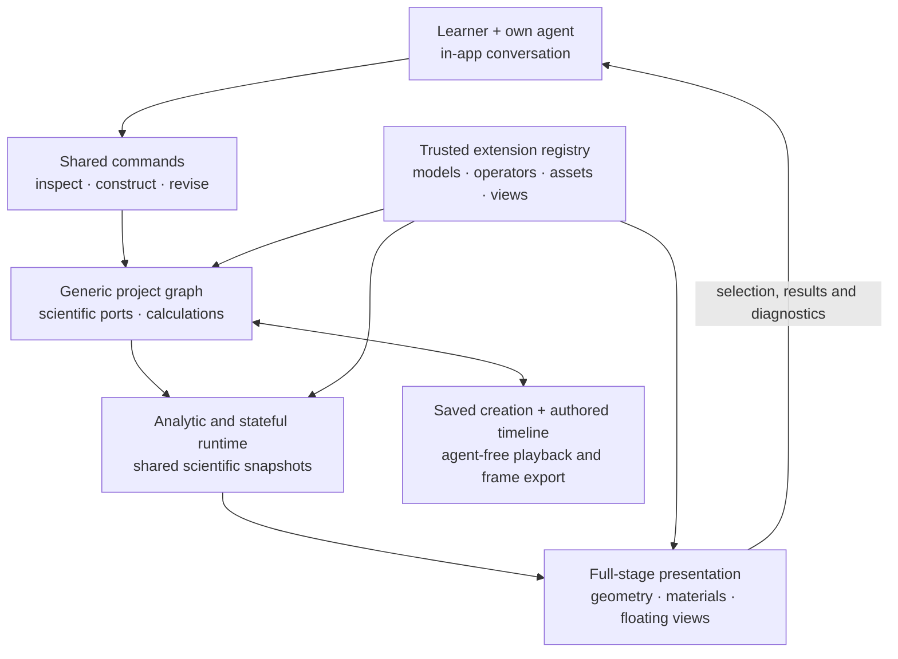

# Cosmic Lego: reusable infrastructure and implementation prompts

Plan dated **2026-11-03**. This replaces the earlier exoplanet-led roadmap.
It describes intended implementation, not capabilities already delivered.
The [README](../README.md) remains the blueprint; inspect the current checkout
and actual handoffs before implementing a task.

Implementation update, **2026-11-03**: F01–F05 are implemented and tested; read
the [F01 handoff](handoffs/F01.md), [F02 handoff](handoffs/F02.md),
[composition guide](composition-kernel.md) and [dataflow guide](scientific-dataflow.md).
The [F03 handoff](handoffs/F03.md) and [registry guide](extension-registry.md) describe
trusted registration and extension contracts. The [F04 handoff](handoffs/F04.md)
and [runtime guide](computation-runtime.md) cover analytic/stateful execution,
cancellation and checkpoints. The [F05 handoff](handoffs/F05.md),
[scene guide](scene-and-assets.md) and [public example](../examples/scene-and-assets.mjs)
cover generic 3D authoring, scientific bindings and reusable assets. The fixture
browser consumes snapshots from the local Node worker host. F06 is next for the
application shell; F06–F12 remain planned. The existing exoplanet demo has not
migrated to the new kernel.

The objective is a reusable authoring application that works with **no astronomy
package installed**. It must assemble scientific components, arithmetic, geometry,
materials, views, and authored sequences through shared interfaces. In-app
conversation with the user's own agent is part of this foundation. The exoplanet
demonstration becomes a later optional package and regression case; improving its
transit curves is not the infrastructure readiness gate.

## The intended working experience

A learner opens an immersive stage, connects a supported agent, and requests a
visualization. The agent discovers available components and uses public commands
to add objects, connect scientific relationships, calculate comparisons, and
arrange views. Authorized changes appear with diagnostics and Undo. Ordinary
code recipes retain loops, functions, and reusable construction logic.

The stage fills the viewport, with actual 3D navigation, depth, selection, and
object inspection. Conversation, plots, equations, and inspectors occupy movable,
foldable floating windows. Scene-only mode has an obvious way to restore them.
Permanent dashboard columns must not determine the visual experience. A plot or
other 2D representation can become the main view when the question benefits;
immersive does not mean every concept needs 3D.

Disconnecting the agent must not close the creation. People continue playback,
exploration, inspection, and saving without an LLM. Saved work should support
both interactive delivery and authored animation.

## One architecture, with replaceable implementations

This diagram shows data and authoring flow, not permission for generic layers
to import domain packages.

Code dependencies run from scientific value contracts and the composition kernel
toward registration, computation, scene rendering, and the application. Domain
modules depend on these interfaces. A **composition root**, the startup module
selecting installed components, injects their registered implementations. Kernel,
runtime, renderer, shell, and agent-session code never import domain packages or
dispatch on names such as planet or transit.

The graph owns identity, references, staged drafts, accepted transactions, and
undo/redo. It does not assume an object is a physical body. Scientific ports
describe units, shape, frame, normalization, time, and required meaning. Arithmetic
builds reusable comparisons over outputs. Computation produces revision-tagged
snapshots; visual bindings map values to geometry, positions, labels, and color
scales. Geometry and materials are reusable assets, not hidden physical laws.

Preserve prototype guarantees: stable handles, atomic edits, reference checks,
shared-time evaluation, and separation of presentation from physical observation.
Do not preserve its one-star graph shape as a universal contract. Extend the
local JavaScript/Node environment incrementally. A functioning 3D renderer is
required, but its adapter boundary leaves later choices open. Evaluate Manim
against a concrete export need later.

## Implementation sequence and copy-ready prompts

Copy an entire linked prompt into a coding-agent conversation. It includes scope,
prerequisites, acceptance checks, and a handoff path. Dependencies mean integrated,
tested interfaces, not merely another agent starting work.

| Task | Implementation prompt | Required result | Depends on |
| --- | --- | --- | --- |
| F01 | [Composition kernel](prompts/F01-composition-kernel.md) | Generic graph, drafts, atomic commands, identities, undo/redo | — |
| F02 | [Scientific dataflow](prompts/F02-scientific-dataflow.md) | Values, ports, frames, normalization, arithmetic, aligned results | F01 |
| F03 | [Extension registry](prompts/F03-extension-registry.md) | Model/operator/asset/view manifests and trusted registration | F01–F02 |
| F04 | [Computation runtime](prompts/F04-computation-runtime.md) | Analytic and basic stateful lifecycles, cancellation, checkpoints | F02–F03 |
| F05 | [Scene and assets](prompts/F05-scene-and-assets.md) | Visual handles, data bindings, actual 3D navigation/selection | F01–F04 |
| F06 | [Planetarium shell](prompts/F06-planetarium-shell.md) | Full-stage application and movable, foldable floating windows | F05 |
| F07 | [Command gateway](prompts/F07-command-gateway.md) | One discoverable, validated write route | F01–F05 |
| F08 | [In-app agent sessions](prompts/F08-in-app-agent-sessions.md) | Conversation, streaming, tools, Stop, real connected adapter | F06–F07 |
| F09 | [Portable projects](prompts/F09-portable-projects.md) | Faithful saving/reopening, assets, source, layout, provenance | F01–F08 |
| F10 | [Timelines and export](prompts/F10-authored-timelines-export.md) | Shared evaluator, local player, scheduled frame sequences | F05–F06, F09 |
| F11 | [Domain-independent readiness](prompts/F11-domain-independent-readiness.md) | Independent complete workflow with astronomy disabled | F01–F10 |
| F12 | [Exoplanet package migration](prompts/F12-exoplanet-package-migration.md) | Existing science as an optional package with regressions | F11 |

F01→F02→F03→F04→F05 are integrated. Start F06 next; F06 and F07 can proceed in parallel with
explicit ownership and agreed interfaces. Their integration enables F08, then
F09→F10→F11. F12 follows the generic gate. Do not dispatch every prompt
simultaneously into one checkout: shared contracts cannot safely acquire
conflicting implementations.

## Readiness fixtures independent of astronomy

Use three small software fixtures throughout the foundation:

1. **Analytic moving points:** `r(t) = r0 + v*t`. Author loops create collections,
   bind positions to geometry, compare speeds, transform declared frames, and
   rearrange plots. Equivalent unit choices preserve values. No star or orbit
   is required.
2. **Accumulator and seeded sequence:** a stepping component tests initialization,
   bounded advancement, cancellation, checkpoint/replay, and reductions/histograms.
   Random resume retains generator identity and state, not merely a seed. This
   is not a validated particle model.
3. **Static scalar/vector field:** known values at declared coordinates test
   array/field ports, instancing, arrows or slices, color mappings, labels,
   provenance, and missing-data diagnostics.

An independent author must construct an unfamiliar arrangement through public
interfaces and an in-app agent conversation, change its structure, save it,
reopen without an agent, and deliver an interactive creation plus a short authored
export. Mock tests cannot replace the real agent roundtrip or browser inspection.
Import-boundary checks and an integration run with astronomy packages disabled
provide evidence of reuse. These fixtures establish neither astronomical
correctness nor educational effectiveness. F12 separately retains the existing
Kepler/photometry reference cases and limits.

## Scientific responsibility and runtime boundaries

| Shared mechanisms enforce | Domain extensions provide |
| --- | --- |
| IDs, references, atomic changes, version/capability checks | Physical entities, relationships, parameter choices, applicability rules |
| Units, declared meaning, frames, normalization, explicit adapters | Why a coupling is physically justified; matching dimensions is insufficient |
| Evaluation lifecycle, snapshots, budgets, cancellation | Equations, integration/sampling algorithms, tolerances, accuracy limits |
| Dependency handling and aligned sample coordinates | Interpretation of measurements, transformations, reductions, approximations |
| A reference-case harness and diagnostics | Relevant reference cases, conserved quantities when applicable, review evidence |
| Geometry/material bindings and visible scale/color metadata | Scientific interpretation of appearance or a supported observation model |

Implement analytic **and basic stateful** capabilities in the foundation.
Analytic models evaluate requested coordinates directly. Stateful models expose
initialization, advancement, extraction, and checkpoint/restore. Models own
numerical methods; the runtime schedules work and identifies results. A global
adaptive solver, all-domain conservation checker, and advanced numerical methods
are unnecessary.

Physical time is independent of display frame rate. Presentation tracks can pause,
seek, or change camera framing without changing physics. Stateful rewind follows
a documented replay/checkpoint policy. Material emission, enlarged markers, and
color scales cannot silently become physical radiation, radius, or temperature.
Computational cycles require an appropriate coupled model/solver; ordinary
object-relationship cycles must not be globally forbidden.

Results and mutations carry project identity, load generation, and revision.
Loading another creation invalidates old jobs and agent turns even when numeric
revisions match. Failed validation preserves accepted state; drafts may remain
incomplete until their connections are supplied.

## The user's agent inside the application

F08 is mandatory. The experience is Copilot-like conversation beside the evolving
visualization, not a requirement to leave the application and manually run a CLI.
A provider-neutral bridge normalizes streaming text, tool progress, completion,
cancellation, authentication needs, and genuine permission requests. Test one
adapter with a real runtime; do not claim universal compatibility.

[ACP](https://agentclientprotocol.com/get-started/architecture) defines
application-to-agent communication; MCP concerns tool/context access. An MCP
server alone does not supply conversational sessions. ACP v1 currently specifies
[local subprocess stdio transport](https://agentclientprotocol.com/protocol/v1/transports).
The local Node companion can host that process; the browser cannot directly
launch it. [Zed's external-agent integration](https://zed.dev/docs/ai/external-agents)
illustrates hosting conversation while an external agent retains its runtime
and authentication. These are precedents, not tested Cosmic Lego integrations.

[Codex app-server](https://learn.chatgpt.com/docs/app-server) is another candidate.
Its help was available locally during planning; authentication and live connection
were not tested. Recheck installed versions, current protocols, and capabilities
in F08. Credentials belong in the supported runtime authentication mechanism,
outside browser storage, project files, and transcripts. A reopened transcript
is not automatically a resumed provider session.

Gateway validation cannot magically constrain an external agent's native filesystem
or shell tools. Use a separate authoring workspace and verified runtime permission
controls where available; report actual limits. Authorized reversible edits apply
with a visible summary and Undo, without repetitive approval dialogs. Stop revokes
further writes and cancels work; committed changes remain until separately undone.

## Extension authors, artifacts, and handoffs

Learners and teachers compose installed blocks. Model authors add trusted local
implementations, contracts, reference cases, and honest experimental/review status.
An equation suggested in conversation becomes supported physics only after
implementation and appropriate checks. Projects carry definitions and requirements,
not permission to execute embedded source or install arbitrary modules.

Preserve the original recipe and its produced graph; expose later divergence.
Save scientific conventions, data identities, assets/licenses, layout, timelines,
and required implementation identities. Derived caches remain separate from
authoritative inputs. Interactive playback and export share one presentation
evaluator with explicit frame times. Identical pixels across graphics devices
are not a blanket reproducibility promise.

Each task writes `docs/handoffs/Fxx.md` with actual interfaces, changed files,
executed checks, assumptions, limits, and downstream implications. Read handoffs
alongside current code. Preserve the approved logo, BSD-3-Clause notices, and
existing scientific evidence. Do not pre-fill future completion claims.

Defer cloud accounts, collaborative editing, GPU/distributed execution, a plug-in
marketplace, universal scientific ontology, symbolic algebra, and support for
every agent or renderer. F11 must demonstrate the generic workflow before F12
migration or substantive new topic development. Real learner studies remain
separate from infrastructure readiness.
